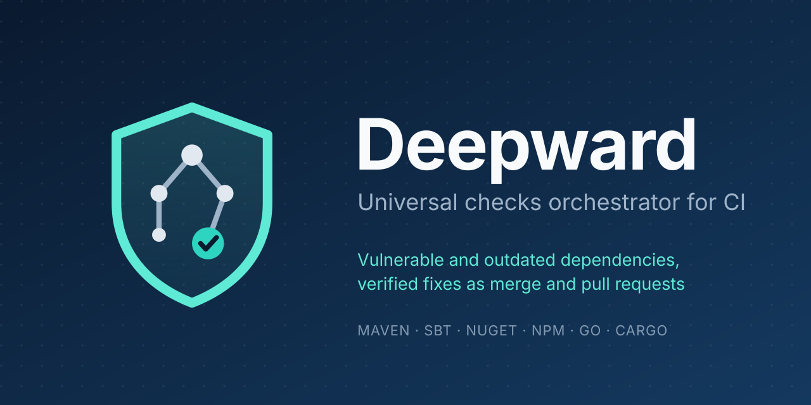
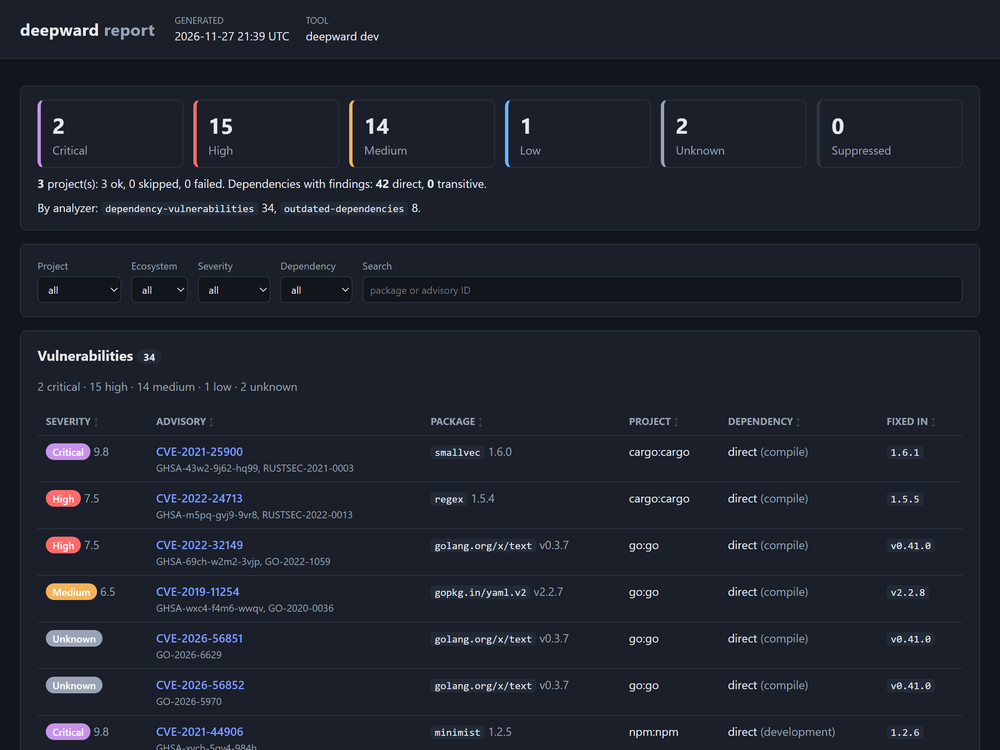
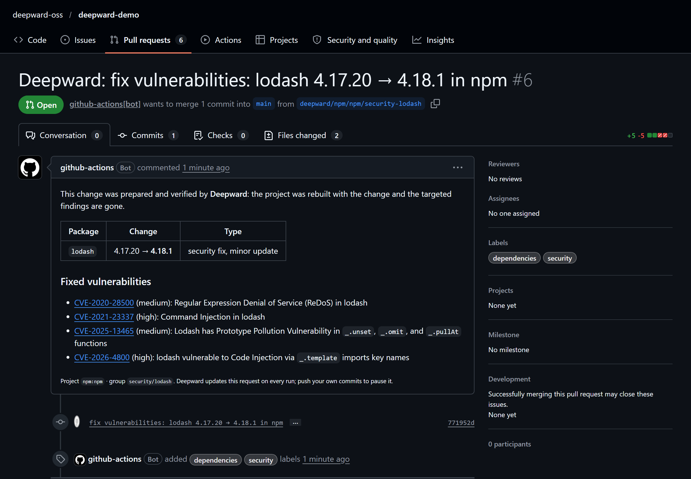

<p align="center"></p>

<h1 align="center">Deepward</h1>

<p align="center"><b>Dependency fixes, verified before they reach your review.</b></p>

<p align="center">
Deepward finds vulnerable and outdated dependencies, transitive ones included,
in Maven, sbt, NuGet, npm/Yarn/pnpm, Go and Cargo projects, and opens merge
and pull requests only for changes it has checked: after the edit the targeted
findings are gone and the dependency graph still resolves.
</p>

<p align="center">
<a href="https://github.com/deepward-oss/deepward/releases"></a>
<a href="https://github.com/deepward-oss/deepward/actions/workflows/ci.yml"></a>
<a href="https://github.com/deepward-oss/deepward/actions/workflows/deepward.yml"></a>
<a href="LICENSE"></a>
<a href="docs/data-licenses.md"></a>
</p>

<!-- docs/assets/demo.gif goes here once rendered with `make demo-gif`. -->

## Quickstart

Scan a project with npm, Yarn, pnpm or Cargo lockfiles, nothing to install:

```sh
docker run --rm -v "$PWD:/src" -w /src ghcr.io/deepward-oss/deepward:0.4.0 scan --fail-on high
```

With `deepward` on your `PATH` (see [Installation](#installation)) and the
project's build tools available:

```sh
deepward fix                # dry run: every verified change as a diff, nothing written
deepward fix --publish      # open or update the merge/pull requests
```

**See it live:** [deepward-oss/deepward-demo](https://github.com/deepward-oss/deepward-demo)
has npm, Go and Cargo projects with known vulnerabilities, the pull requests
Deepward opened for them and the reports of every run.

## Why Deepward

- **The bump that leaves the vulnerability in place.** A version upgrade
  does not always remove the vulnerable transitive package. Deepward scans
  the edited copy again and keeps a change only if the targeted findings are
  gone. Transitive vulnerabilities are fixed by upgrading the direct
  dependency that brings them in or by pinning the fixed version, whichever
  passes first ([configuration](docs/configuration.md#transitive-vulnerabilities)).
- **The pull request that breaks resolution.** Every change is checked by
  rebuilding the dependency graph with your own build tools before a request
  exists. Changes are verified in batches, and a batch that fails is split
  until the breaking change is found. Rejected changes never reach a request
  ([how fixes work](docs/publishing.md)).
- **The noisy diff.** Only the version token changes: the literal, the
  `${property}`, the shared `val`, the `PackageReference`. Formatting and
  comments stay as they were; lockfiles are updated by the package manager.
  If your project needs more, `fix.postTasks` runs your own commands, such
  as code generation or tests, before the commit.
- **The fix that silently did not happen.** Anything Deepward cannot change
  is listed as `manual` with the reason and, where possible, a suggestion.
  Changes that fail verification are reported with the reason, and can
  optionally be published as clearly labelled `[unverified]` requests.

Under the hood Deepward is a checks orchestrator: dependency analysis is its
built-in plugin set, and other checkers (static analyzers, linters, secret
scanners) are added through configuration, so one report, one quality gate
and one set of ignore rules cover them all ([integrations](docs/integrations.md)).

## How it compares

| | Deepward | Dependabot | Renovate | Trivy |
|---|:---:|:---:|:---:|:---:|
| Re-scans the edited project before opening a request | yes | partial&nbsp;¹ | partial&nbsp;² | no&nbsp;³ |
| Opens requests on both GitHub and GitLab | yes | no&nbsp;⁴ | yes | no&nbsp;³ |
| Reports in HTML, JSON and SARIF | yes | no | no | partial&nbsp;⁵ |

<sub>
As of November 2026, from each tool's documentation.
¹ Checks that a fixed version can be installed without disrupting the graph, then relies on CI on the pull request
(<a href="https://docs.github.com/en/code-security/dependabot/dependabot-security-updates/about-dependabot-security-updates">docs</a>).
² Regenerates lockfiles with the package manager and can wait for status checks before creating the pull request; no re-scan of the vulnerability
(<a href="https://docs.renovatebot.com/configuration-options/">docs</a>).
³ A scanner: it reports findings and does not open requests
(<a href="https://trivy.dev/latest/docs/getting-started/">docs</a>).
⁴ A GitHub feature
(<a href="https://docs.github.com/en/code-security/reference/supply-chain-security/supported-ecosystems-and-repositories">docs</a>).
⁵ JSON and SARIF natively, HTML through a template
(<a href="https://trivy.dev/latest/docs/configuration/reporting/">docs</a>).
</sub>

## Works with

| | |
|---|---|
| **Ecosystems** | Maven, sbt, NuGet, npm, Yarn, pnpm, Go modules, Cargo ([specifics](docs/ecosystems)) |
| **Resolution** | runs Maven, sbt, dotnet and Go; reads the lockfiles npm, Yarn, pnpm and Cargo wrote. Nothing in the repository is modified by a scan |
| **Vulnerability data** | OSV.dev, online or offline, and optionally the GitHub Advisory Database; licenses checked and credited ([data licenses](docs/data-licenses.md)) |
| **CI** | GitLab CI and GitHub Actions detected automatically; anywhere else with flags ([CLI](docs/cli.md)) |
| **Requests** | GitLab merge requests (gitlab.com, self-managed) and GitHub pull requests (github.com, Enterprise Server) |
| **Extending** | ecosystems, analyzers, advisory sources, reporters and platforms are plugins behind a public SDK ([plugins](docs/plugins.md)) |

A minimal GitHub Actions job that scans on every pull request:

```yml
name: deepward
on: pull_request
permissions:
  contents: read
jobs:
  scan:
    runs-on: ubuntu-latest
    steps:
      - uses: actions/checkout@v4
      - name: Install Deepward
        run: |
          v=0.4.0
          curl -fsSL "https://github.com/deepward-oss/deepward/releases/download/v$v/deepward_${v}_linux_amd64.tar.gz" \
            | tar -xz -C "$RUNNER_TEMP" deepward
          echo "$RUNNER_TEMP" >> "$GITHUB_PATH"
      - run: deepward scan --fail-on high
```

Scheduled fixes, SARIF upload, GitLab CI and token setup are in
[docs/publishing.md](docs/publishing.md#recommended-ci-setup).

## What you get

**One report for every project in the repository**, with filters by project,
ecosystem, severity and dependency type, plus the same data as JSON and SARIF:

<p align="center"><a href="https://github.com/deepward-oss/deepward-demo/actions/workflows/deepward.yml"></a></p>

**A request per fix, with the evidence in it**: the version change, every
vulnerability it removes, and a note that it was verified. Only the version
token and the lockfile change:

<p align="center"><a href="https://github.com/deepward-oss/deepward-demo/pull/6"></a></p>

## Installation

Download an archive for Linux, macOS or Windows (amd64 or arm64) from the
[releases page](https://github.com/deepward-oss/deepward/releases) and put
`deepward` on your `PATH`. Every release has a `checksums.txt` and SBOMs:

```sh
sha256sum --check --ignore-missing checksums.txt
```

The container image (linux/amd64 and linux/arm64) has only the static
binary. It can scan lockfile-based projects (npm, Yarn, pnpm, Cargo) as is.
Maven, sbt, .NET and Go need their build tools, so copy the binary into an
image that has them:

```sh
docker run --rm -v "$PWD:/src" -w /src ghcr.io/deepward-oss/deepward:0.4.0 scan
```

```dockerfile
COPY --from=ghcr.io/deepward-oss/deepward:0.4.0 /deepward /usr/local/bin/deepward
```

With Go 1.26 or later:

```sh
go install github.com/deepward-oss/deepward/cmd/deepward@v0.4.0
```

Versions follow SemVer; see [docs/versioning.md](docs/versioning.md) and the
[changelog](CHANGELOG.md).

## Documentation

| Topic | |
|-------|-|
| Commands, exit codes, CI detection | [docs/cli.md](docs/cli.md) |
| `deepward.yaml` reference | [docs/configuration.md](docs/configuration.md), [schema](schema/deepward.schema.json) |
| Maven, sbt, NuGet, npm/Yarn/pnpm, Go, Cargo specifics | [docs/ecosystems/](docs/ecosystems) |
| Tools, wrappers, containers, downloads | [docs/toolchain.md](docs/toolchain.md) |
| Add-ons, setup steps, config-only integrations | [docs/integrations.md](docs/integrations.md) |
| Fixes and merge/pull requests, CI setups | [docs/publishing.md](docs/publishing.md) |
| Writing plugins | [docs/plugins.md](docs/plugins.md) |
| Vulnerability data licenses | [docs/data-licenses.md](docs/data-licenses.md) |
| Versions, compatibility, releases | [docs/versioning.md](docs/versioning.md), [CHANGELOG.md](CHANGELOG.md) |

## Development

```sh
make build        # bin/deepward
make test         # unit, doc and end-to-end tests
make cover-check  # coverage gates: >=95% domain/app, >=85% adapters, >=90% overall
make lint         # golangci-lint, including module-boundary rules
make licenses     # dependencies must be MIT-compatible
make integration  # real Maven, sbt, .NET SDK, Node.js, Go and Rust in Docker (needs Docker and network)
make dist         # dist/ binaries for linux/amd64, linux/arm64, darwin/arm64, windows/amd64
make snapshot     # local GoReleaser run: archives, checksums, SBOMs, image (needs goreleaser, syft, Docker)
make image        # container image built from source
make demo-gif     # docs/assets/demo.gif from docs/assets/demo.tape (needs vhs, Node.js and npm)
```

Deepward checks its own dependencies: the
[deepward workflow](.github/workflows/deepward.yml) scans the root Go module
with the latest release on every push and pull request, and a weekly job
opens fix requests against `develop`. The scope is set in
[deepward.yaml](deepward.yaml), which excludes the intentionally vulnerable
test fixtures.

The requirements are in [openspec/specs](openspec/specs). The proposals and
design decisions behind them are in
[openspec/changes/archive](openspec/changes/archive).

## License

MIT, see [LICENSE](LICENSE). Authors are listed in [AUTHORS](AUTHORS).
